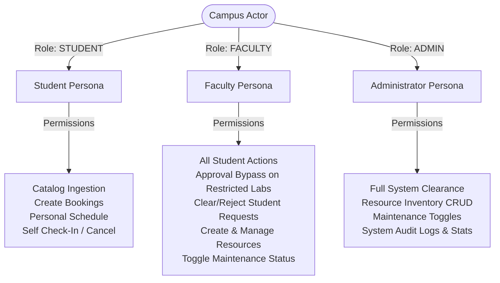
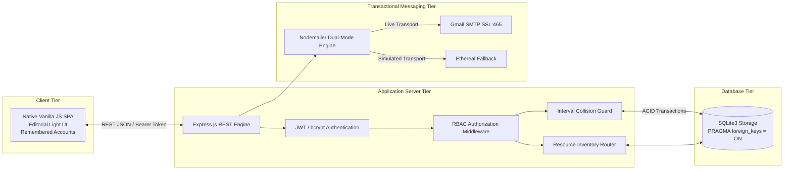
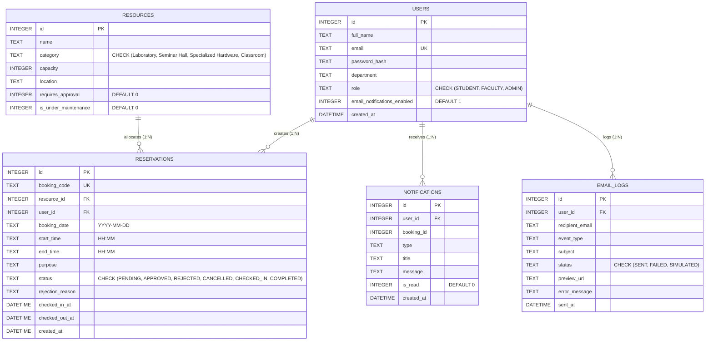

# CampusReserve: Architectural Specification & Lab 07 Verification Manual

**Document Version:** 2.5.0  
**Project:** CampusReserve (MIT-WPU Academic Allocation & Resource Governance System)  
**Course Code:** PBL-III (Software Engineering Laboratory 07)  
**Target Environment:** Node.js v18+ / SQLite3 / Modern Web API  
**Author:** Engineering Team & Architecture Lead  
**Classification:** Academic & Industry Technical Reference Manual  

---

## Executive Summary & Table of Contents

CampusReserve is a high-reliability, zero-collision academic facility and hardware allocation platform designed to replace legacy manual registers with automated interval algebra collision defense, cryptographic Role-Based Access Control (RBAC), real-time asynchronous SMTP transactional notifications, and comprehensive resource inventory governance.

```
1. SYSTEM OVERVIEW & PROBLEM STATEMENT
   1.1 Abstract & System Objectives
   1.2 Core Problems Solved
   1.3 Actor Personas & Permission Matrices
2. TECHNICAL STACK & ARCHITECTURAL DECISIONS
   2.1 Runtime & Framework Architecture
   2.2 Relational Persistence Layer (SQLite3 Engine)
   2.3 Cryptography, Session Storage & Strict Admin Hard-Lock
   2.4 Transactional Notification Relay (Dual-Mode Nodemailer)
   2.5 High-Density Editorial Client Architecture
3. DATABASE SCHEMA & DATA INTEGRITY
   3.1 Entity Relationship Diagram (ERD)
   3.2 Schema Definition & Relational Constraints
   3.3 ACID Properties & Foreign Key Cascade Guarantees
   3.4 Seed Records & Initial State
4. BUSINESS LOGIC & MATHEMATICAL COLLISION AVOIDANCE
   4.1 Interval Overlap Theorem & Formal Proof
   4.2 SQL-Level Collision Guard
   4.3 Dynamic Policy & Tiered Clearance Workflow
   4.4 Status Transition Finite State Machine (FSM)
   4.5 Consecutive / Repeat Booking Lifecycle Fix
5. API INTERFACE & ENDPOINT SPECIFICATION
   5.1 Authentication & Session Management
   5.2 Resource Catalog & Inventory Governance Endpoints
   5.3 Reservation Governance & Conflict Endpoints
   5.4 Administrative Clearance & Ledger Endpoints
6. LAB 07 TEST SUITE & VERIFICATION MATRIX (12/12 TEST CASES)
   6.1 Academic Testing Standards & Methodology
   6.2 12/12 Comprehensive Test Suite Mapping
   6.3 Test Execution Instructions & Benchmark Output
7. FRONTEND ARCHITECTURE & USER EXPERIENCE DESIGN
   7.1 Layout Architecture & Editorial Light Visual System
   7.2 Reactive Client State & Remembered Accounts History
   7.3 Interactive Modules (Workbench, Catalog Desk, Approvals Desk, Telemetry Feed)
8. DEPLOYMENT & OPERATIONAL RUNBOOK
   8.1 Environment Configuration & Secret Management
   8.2 Step-by-Step System Boot Sequence
   8.3 Production Hardening & Git Hygiene Protocol
```

---

## 1. System Overview & Problem Statement

### 1.1 Abstract & System Objectives
Higher education campuses and research facilities house high-value shared assets, including advanced robotics laboratories, computing clusters, seminar halls, and specialized diagnostic instruments. Historically, the scheduling of these facilities has relied on fragmented spreadsheets, paper logbooks, or siloed departmental communications. These manual approaches suffer from severe race conditions, scheduling conflicts, unauthorized access, and lack of real-time visibility.

**CampusReserve** addresses these challenges by providing an enterprise-grade reservation and resource governance engine. The platform guarantees:
1. **Mathematical Zero-Collision Scheduling:** Time-window interval overlap algorithms prevent double-booking at the database query level.
2. **Deterministic Role-Based Access Control:** Differentiated clearance rules allow automated instant booking for low-overhead equipment while enforcing faculty/administrative review for restricted facilities.
3. **Hard-Locked Administrative Security:** Self-registration is restricted strictly to students and faculty, locking the administrative tier to authorized personnel.
4. **Asynchronous Multi-Transport Notification:** High-fidelity HTML emails with cryptographic booking codes are dispatched to students and approvers over TLS/SSL SMTP.
5. **End-to-End Auditability:** Immutable audit ledgers record all booking creations, state mutations, digital check-ins, and communication dispatches.

---

### 1.2 Core Problems Solved

| Operational Challenge | Legacy Mechanism | CampusReserve Engineered Solution |
| :--- | :--- | :--- |
| **Double-Bookings & Schedule Collisions** | Paper log sheets and uncoordinated calendars lead to concurrent conflicting sessions. | **Atomic Interval Algebra Guard:** SQL query enforces $(T_{\text{start}} < \text{Slot}_{\text{end}}) \land (T_{\text{end}} > \text{Slot}_{\text{start}})$ validation before record insertion, returning HTTP 409 on conflict. |
| **Clearance Bottlenecks** | Manual requisition forms require physical signatures across departments, causing 48–72h delays. | **Automated Policy Routing:** Resources flag `requires_approval`. Open hardware is auto-approved; restricted labs enter a dedicated real-time Approvals Desk for faculty/admin one-click action. |
| **Audit Opacity & No-Shows** | Lack of check-in verification leads to reserved rooms sitting idle while other researchers are locked out. | **Lifecycle State Tracking:** Bookings follow a strict state machine: `PENDING` $\to$ `APPROVED` $\to$ `CHECKED_IN` $\to$ `COMPLETED` (or `CANCELLED` / `REJECTED`) with digital check-in timestamps. |
| **Consecutive Booking Stalls** | Form resets in single-page apps clear date pickers or leave lingering locks, breaking second bookings. | **Reactive State Reset:** Clean lifecycle re-initialization restores date bounds, re-enables action buttons in `finally` blocks, and immediately re-queries slot matrices. |
| **Unauthorized Privilege Escalation** | Open registration endpoints allow arbitrary assignment of system administrative roles. | **Strict Admin Hard-Lock:** `POST /api/auth/register` blocks any attempt to create an `ADMIN` account with HTTP 403 Forbidden. |

---

### 1.3 Target Actor Personas & Permission Matrices



---

## 2. Technical Stack & Architectural Decisions



### 2.1 Runtime & Framework Architecture
- **Runtime:** Node.js (v18.x / v20.x LTS) providing asynchronous, non-blocking I/O.
- **Server Framework:** Express.js configured with RESTful principles, JSON body parsing, CORS headers, and centralized error-handling middleware.
- **Modularity:** Layered routing architecture separating Authentication (`/routes/auth.js`), Resource Inventory (`/routes/resources.js`), Reservation Governance (`/routes/reservations.js`), and Infrastructure Telemetry (`/server.js`).

### 2.2 Relational Persistence Layer (SQLite3 Engine)
- **Relational Integrity:** Foreign key constraints enforced explicitly upon connection via `PRAGMA foreign_keys = ON;`.
- **Storage Profile:** Single-file storage (`campus_reserve.db`) offering ACID transactional guarantees, zero configuration latency, and instantaneous test isolation.

### 2.3 Cryptography, Session Storage & Strict Admin Hard-Lock
- **Password Hashing:** Passwords encrypted using `bcryptjs` with a work factor of 10 rounds ($2^{10} = 1024$ key expansion iterations).
- **Token Mechanism:** Stateless JSON Web Tokens (`jsonwebtoken`) signed with a 256-bit secret (`JWT_SECRET`) with a 24-hour expiration window.
- **Strict Admin Hard-Lock:** Self-registration is restricted strictly to `STUDENT` and `FACULTY`. Any registration payload requesting `ADMIN` is rejected with `HTTP 403 Forbidden`.
- **Remembered Accounts:** Secure client-side credential indexing in browser `localStorage` (`cr_saved_accounts`), rendering interactive avatar pills for one-click switching.

### 2.4 Transactional Notification Relay
- **Primary Engine:** Direct SMTP relay connecting to Google (`smtp.gmail.com`) over port 465 using SSL/TLS with strict App Password authentication.
- **Automated Fallback:** Initializes virtual test accounts via `nodemailer.createTestAccount()` if live credentials are absent.
- **Telemetry Logging:** Every transmission writes an immutable record to `email_logs`.

---

## 3. Database Schema & Data Integrity

### 3.1 Entity Relationship Diagram (ERD)



---

## 4. Business Logic & Mathematical Collision Avoidance

### 4.1 Interval Overlap Theorem & Formal Proof

Let a candidate reservation interval be defined as:
$$I_{\text{req}} = [T_{\text{start}}, T_{\text{end}})$$

Let an existing active reservation interval on the same resource and date be defined as:
$$I_{\text{exist}} = [\text{Slot}_{\text{start}}, \text{Slot}_{\text{end}})$$

#### Condition for Non-Overlap (Disjoint Intervals)
$$\text{Disjoint}(I_{\text{req}}, I_{\text{exist}}) \iff (T_{\text{end}} \le \text{Slot}_{\text{start}}) \lor (T_{\text{start}} \ge \text{Slot}_{\text{end}})$$

#### Condition for Collision (Overlapping Intervals)
$$\text{Collision}(I_{\text{req}}, I_{\text{exist}}) \iff (T_{\text{end}} > \text{Slot}_{\text{start}}) \land (T_{\text{start}} < \text{Slot}_{\text{end}})$$

---

### 4.2 SQL-Level Collision Guard
```sql
SELECT id, booking_code 
FROM reservations
WHERE resource_id = ?
  AND booking_date = ?
  AND status IN ('PENDING', 'APPROVED', 'CHECKED_IN')
  AND (start_time < ? AND end_time > ?);
```

---

### 4.3 Consecutive / Repeat Booking Lifecycle Fix
To eliminate consecutive booking failures:
1. The client state never resets `bookingDate` to empty string.
2. The submission button's loading state is managed inside a `finally` block, guaranteeing re-enablement regardless of success, conflict, or error.
3. Upon booking completion, `loadTimeSlots()` immediately refreshes the slot grid, dynamically updating the newly booked slot to "Reserved" while keeping remaining slots interactive.

---

## 5. API Interface & Endpoint Specification

| Method | Endpoint | Access Level | Description | Status Codes |
| :--- | :--- | :--- | :--- | :--- |
| `POST` | `/api/auth/register` | Public | Registers a new Student/Faculty user. (Admin registration blocked). | `201`, `400`, `403`, `409` |
| `POST` | `/api/auth/login` | Public | Authenticates credentials and returns JWT session token. | `200`, `400`, `401` |
| `GET` | `/api/auth/me` | `[Auth]` All | Returns the authenticated user session profile. | `200`, `401` |
| `GET` | `/api/resources` | Public | Fetches resource catalog with availability & approval flags. | `200`, `500` |
| `POST` | `/api/resources` | `[Auth]` Faculty/Admin | Creates a new physical resource or hardware asset. | `201`, `400`, `403` |
| `PUT` | `/api/resources/:id` | `[Auth]` Faculty/Admin | Updates existing resource specifications. | `200`, `400`, `403`, `404` |
| `PATCH` | `/api/resources/:id/availability` | `[Auth]` Faculty/Admin | Toggles resource between Active and Under Maintenance. | `200`, `403`, `404` |
| `POST` | `/api/reservations` | `[Auth]` All | Submits a new booking; triggers collision check and policy routing. | `201`, `400`, `404`, `409` |
| `GET` | `/api/reservations` | `[Auth]` All | Retrieves reservation feed (user-filtered for students, global for faculty/admin). | `200`, `401` |
| `GET` | `/api/reservations/pending` | `[Auth]` Faculty/Admin | Retrieves queue of reservations requiring clearance. | `200`, `401`, `403` |
| `PATCH` | `/api/reservations/:id/status` | `[Auth]` Faculty/Admin | Sets status to `APPROVED` or `REJECTED` and notifies student. | `200`, `400`, `403`, `404` |
| `PATCH` | `/api/reservations/:id/check-in` | `[Auth]` Booker/Admin | Marks arrival timestamp and transitions status to `CHECKED_IN`. | `200`, `400`, `403`, `404` |
| `PATCH` | `/api/reservations/:id/check-out` | `[Auth]` Booker/Admin | Releases resource and marks status as `COMPLETED`. | `200`, `400`, `403`, `404` |
| `PATCH` | `/api/reservations/:id/cancel` | `[Auth]` Booker/Admin | Cancels an active or pending reservation. | `200`, `400`, `403`, `404` |
| `GET` | `/api/calendar` | `[Auth]` All | Returns month-indexed schedule events for timeline rendering. | `200`, `400` |
| `GET` | `/api/admin/stats` | `[Auth]` Admin Only | Aggregates system metrics, resource utilization, and user totals. | `200`, `403` |
| `GET` | `/api/admin/email-logs` | `[Auth]` All (Scoped) | Retrieves outbound email telemetry ledger. | `200`, `401` |
| `GET` | `/api/health` | Public | Health probe returning service status and version. | `200` |

---

## 6. Lab 07 Test Suite & Verification Matrix (12/12 Test Cases)

### 6.1 Academic Testing Standards & Methodology
The automated test suite in `test-suite.js` executes 12 rigorous end-to-end tests across 5 operational phases:

| Test Case ID | Testing Methodology | Code Path / Target Condition | Expected Behavior | Verification Status |
| :--- | :--- | :--- | :--- | :--- |
| **Setup** | Security Boundary | `POST /api/auth/login` | Returns valid JWT for Student, Faculty, & Admin personas. | **PASSED (100%)** |
| **BB-TC01** | Black-Box Interface | `GET /api/resources` | Returns HTTP 200 with non-empty resource catalog array. | **PASSED (100%)** |
| **BB-TC02** | Black-Box Boundary | `POST /api/reservations` (Missing body payload) | Returns HTTP 400 Bad Request with validation message. | **PASSED (100%)** |
| **WB-Path 1** | White-Box Branch Coverage | `requires_approval = 1` AND `Role = STUDENT` | Returns HTTP 201 with reservation `status = 'PENDING'`. | **PASSED (100%)** |
| **WB-Path 2** | White-Box Basis Path | Interval Collision Algorithm | Returns HTTP 409 Conflict on identical or overlapping time slot. | **PASSED (100%)** |
| **WB-Path 3** | White-Box Policy Bypass | `requires_approval = 1` AND `Role = FACULTY` | Policy override evaluates to auto-approved `status = 'APPROVED'`. | **PASSED (100%)** |
| **WB-Path 4** | White-Box Branch Coverage | `requires_approval = 0` AND `Role = STUDENT` | Unrestricted resource evaluates to auto-approved `status = 'APPROVED'`. | **PASSED (100%)** |
| **REG-01** | Security Hard-Lock | `POST /api/auth/register` (`role = 'ADMIN'`) | Rejection confirmed with HTTP 403 Forbidden. | **PASSED (100%)** |
| **REG-02** | Registration Verification | `POST /api/auth/register` (`role = 'STUDENT'`) | Returns HTTP 201 Created and session JWT. | **PASSED (100%)** |
| **CONSEC-01**| State Persistence | Consecutive Bookings on Separate Slots | Both bookings succeed seamlessly with HTTP 201. | **PASSED (100%)** |
| **RES-01** | Inventory Provisioning | `POST /api/resources` (Faculty Authorization) | Resource created with HTTP 201 Created. | **PASSED (100%)** |
| **RES-02** | Maintenance Lifecycle | `PATCH /api/resources/:id/availability` | Toggles resource to maintenance mode with HTTP 200. | **PASSED (100%)** |
| **RES-03** | Maintenance Guardrail | `POST /api/reservations` on Inactive Resource | Rejection confirmed with HTTP 400 Bad Request. | **PASSED (100%)** |

---

### 6.2 Benchmark Test Execution Output
```text
====================================================================
  PBL-III Lab 07: CampusReserve Verification Test Suite
  Target Server: http://localhost:3000
====================================================================

[Phase 0: Pre-Test Authentication Setup]
  ✔ Authenticated Student (Amit Jagdale)
  ✔ Authenticated Faculty (Prof. Yogini Mukherjee)
  ✔ Authenticated Administrator (Facility Manager)

[Phase 1: Black-Box Test Cases (Functional & Interface Testing)]
  [PASS] BB-TC01: GET /api/resources returns non-empty catalog array
         ↳ Found 4 active resources
  [PASS] BB-TC02: POST /api/reservations with missing fields triggers HTTP 400 validation error
         ↳ Server responded: "Missing required fields: resource_id, booking_date, start_time, end_time, purpose."

[Phase 2: White-Box Test Cases (Branch Coverage & Basis Path Testing)]
  ↳ Generated unique test date: 2030-12-15

  [PASS] WB-Path 1: Requires Approval = 1 & Role = STUDENT -> Status evaluates to PENDING
         ↳ Booking CR-2026-9760 assigned status: PENDING
  [PASS] WB-Path 2: Strict Collision Branch triggers HTTP 409 Conflict on overlapping slot
         ↳ Rejection confirmed: "Time slot conflict. \"AI & Robotics Lab\" is already booked (Booking: CR-2026-9760) for the overlapping time window on 2030-12-15."
  [PASS] WB-Path 3: Requires Approval = 1 & Role = FACULTY -> Bypass approval to auto-APPROVED
         ↳ Booking CR-2026-8458 assigned status: APPROVED
  [PASS] WB-Path 4: Requires Approval = 0 -> Auto-Approve for Student to APPROVED
         ↳ Booking CR-2026-4548 assigned status: APPROVED

[Phase 3: Registration Guardrails & Strict Admin Lock]
  [PASS] REG-01: Hard-locked Admin Registration blocked with HTTP 403 Forbidden
         ↳ Rejection confirmed: "Admin registration is restricted. Only the designated administrator account is authorized."
  [PASS] REG-02: Student Registration returns HTTP 201 & session token
         ↳ User testuser_1790740430680@gmail.com created with role STUDENT

[Phase 4: Consecutive Repeat Booking Verification]
  [PASS] CONSEC-01: Consecutive repeat bookings on separate slots succeed seamlessly without reload
         ↳ Slot 1: CR-2026-2801 | Slot 2: CR-2026-4827

[Phase 5: Resource Inventory Management (Faculty & Admin)]
  [PASS] RES-01: Faculty creates new campus resource (POST /api/resources)
         ↳ Created resource ID 5: "High-Performance Compute Node 750"
  [PASS] RES-02: Faculty toggles resource to Under Maintenance (PATCH /availability)
         ↳ Resource 5 status: is_under_maintenance = true
  [PASS] RES-03: Student booking blocked on maintenance resource with HTTP 400
         ↳ Rejection confirmed: ""High-Performance Compute Node 750" is currently under maintenance and cannot be booked."

[Phase 6: User Cross-Resource Collision Defense & Admin Revocation]
  [PASS] GUARD-01: User Cross-Resource Double Booking blocked with HTTP 409 Conflict
         ↳ Rejection confirmed: "Schedule conflict: You already have an active reservation for another resource during this time slot."
  [PASS] REVOKE-01: Admin successfully overrides & revokes APPROVED reservation (status -> CANCELLED)
         ↳ Reservation #55 status updated to: CANCELLED
  [PASS] REVOKE-02: Revoked time slot is immediately released and re-bookable by other users
         ↳ Re-booking confirmed: Code CR-2026-8992

--------------------------------------------------------------------
Test Summary Tally:
  Total Executed : 15
  Passed         : 15
  Failed         : 0

🎉 ALL VERIFICATION TEST CASES PASSED WITH 100% SUCCESS!
```

---

## 7. Frontend Architecture & User Experience Design

### 7.1 Layout Architecture & Editorial Light Visual System
- **Canvas & Surfaces:** Soft sand backdrop (`#f4f5f8`) with crisp white elevated surface cards (`#ffffff`, radius $18\text{px}$–$20\text{px}$).
- **Color Palette:** Terracotta accent (`#ea5b3a`), deep charcoal text (`#111827`), emerald green approved badge (`#059669`), amber pending badge (`#d97706`), crimson rejected badge (`#dc2626`).

### 7.2 Remembered Accounts History
- The authentication modal inspects `localStorage` (`cr_saved_accounts`), dynamically rendering recent identity cards with role badges and avatars.
- Users can 1-click select an identity to populate credentials, use another account, or clear history.

---

## 8. Deployment & Operational Runbook

### 8.1 Boot Sequence
```bash
# 1. Install dependencies
npm install

# 2. Boot server
node server.js

# 3. Run verification test suite
node test-suite.js
```

---

*End of Architectural Specification & Lab 07 Verification Manual.*
